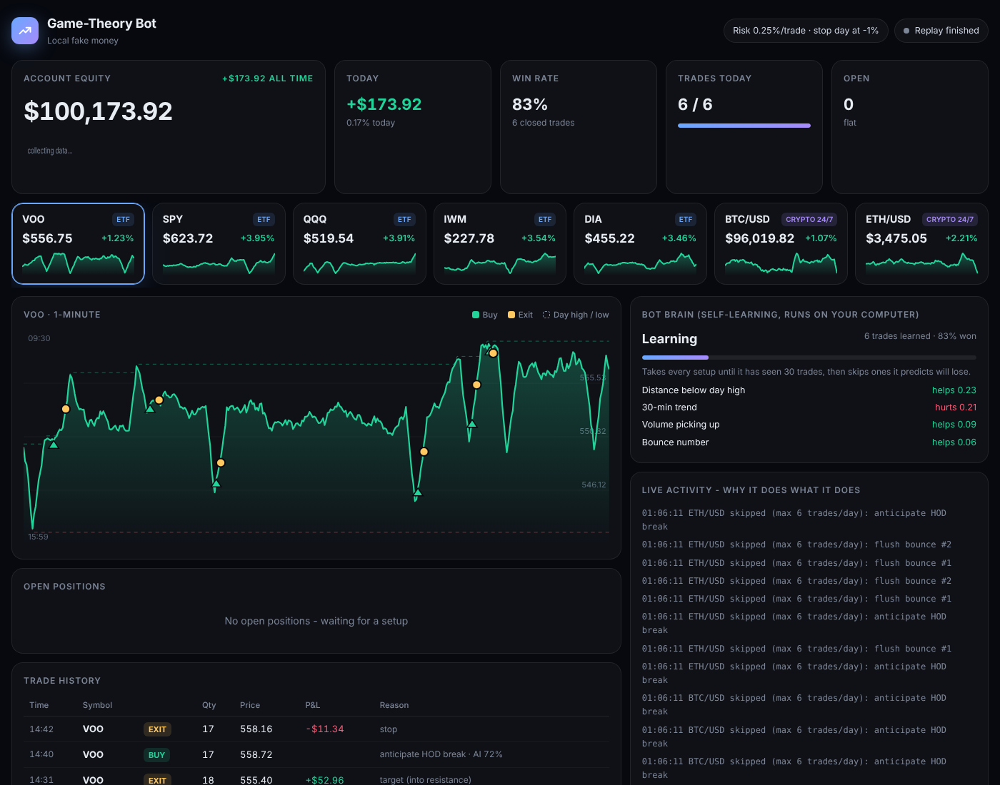

# Game-theory paper-trading bot

Rules from a "trading is poker" day-trading talk, coded as a 1-minute-bar strategy.
See `bot/strategy.py` for how each rule maps to code.

```bash
python -m bot.simulate                 # offline test on synthetic data (no keys)
python -m bot.simulate my_bars.csv     # your own bars: t,o,h,l,c,v
python -m bot.live_alpaca SPY 10       # Alpaca *paper* account, needs APCA_API_KEY_ID/SECRET
```

The synthetic results don't count as evidence: the generator puts in the same
patterns the strategy looks for. Test on real historical bars before you believe anything.
Paper trading only.

## Real-time paper bot

**Step-by-step setup: see [SETUP.md](SETUP.md).**



```bash
python -m bot.run                         # VOO SPY QQQ IWM DIA + BTC/ETH, $100k fake money, opens http://localhost:8000
python -m bot.run --broker alpaca         # same, but orders go to your Alpaca PAPER account
python -m bot.run --replay                # replay today's bars now (after hours)
python -m bot.report                      # every trade + win rate, drawdown, verdict
python -m bot.report --alpaca             # same, read from your Alpaca paper account
```

Alpaca paper setup: sign up free at alpaca.markets, open the Paper Trading dashboard, create API keys, then
`export APCA_API_KEY_ID=... APCA_API_SECRET_KEY=...` (Windows: `set ...`). Alpaca orders are bracket
orders, so the stop-loss sits at the broker even if your computer goes off.

Risk-averse defaults: long only, 0.25% of equity risked per trade, max 10% of equity per position,
max 6 trades/day, ETFs only 9:50-15:30 ET and flat by 15:50 ET, crypto 24/7 (long only), stops for the day at -1%.
Change with `--risk --max-position --max-trades --max-loss --allow-shorts`.

`bot.report` says "ready to consider a small real-money test" only after 40+ trading days,
100+ trades, profit factor >= 1.3 and a net profit. This code only ever trades paper.

## The bot's own brain (no Claude, no internet)
The bot never calls Claude or any AI service while it runs. Its decisions come from:
1. **Rules** (`bot/strategy.py`) - the game-theory setups.
2. **A self-learning filter** (`bot/learner.py`) - a small machine-learning model (logistic regression,
   plain Python) that records 12 facts about every setup and whether the trade won. After 30 trades
   it skips setups it predicts have under a 45% chance to win. Its memory is saved in `model.json`.
   See what it learned in the "Bot brain" panel. Turn it off with `--no-learn`; delete `model.json` to reset it.
